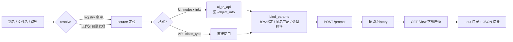

# ComfyUI Named Runner

**把本机 ComfyUI 变成一个「按名字调用 → 传参 → 拿产物」的生成后端。**

一个零依赖（只用 Python 标准库）的命令行工具 + Python 客户端库：你不需要每次都打开 ComfyUI 网页、拖节点、点 Run，也不需要自己拼 `POST /prompt` 的 API 图。工作流仍然在 ComfyUI 的图形界面里搭（或直接用别人导出的 API 图），然后在命令行里用一个**别名**调用它。

```powershell
python scripts\comfy.py t2i "雨后的江南小巷，水彩" --width 1536 --height 864 --out .\图
python scripts\comfy.py i2i "改成油画风格" --image .\photo.png --out .\图
python scripts\comfy.py dub "弯弯的月儿小小的船。" --voice 灵小安 --out .\配音
```

---

## 目录

- [它解决什么问题](#它解决什么问题)
- [特性](#特性)
- [快速开始](#快速开始)
- [平台支持（Windows / macOS / Linux）](#平台支持windows--macos--linux)
- [命令速查](#命令速查)
- [工作流别名机制](#工作流别名机制)
- [图像能力](#图像能力)
- [语音能力](#语音能力)
- [退出码与错误模型](#退出码与错误模型)
- [项目结构](#项目结构)
- [作为 AI Agent Skill 使用](#作为-ai-agent-skill-使用)
- [文档](#文档)
- [兼容性与实测](#兼容性与实测)
- [许可与致谢](#许可与致谢)

---

## 它解决什么问题

ComfyUI 把「画工作流」做得很舒服，把「批量、脚本化、被其他程序调用」留给了用户：

| 常见痛点 | 本项目的做法 |
|---|---|
| 每次出图都要开浏览器、点 Run、手动存文件 | 一条命令提交 + 自动下载产物到指定目录 |
| 官方 API 要求提交的图是 `{"节点id": {"class_type": ...}}` 格式，而界面保存的是 `nodes` + `links` | 内置 **UI → API 转换器**（按 `/object_info` 还原控件值、解析连线、处理旁通/静音/Reroute） |
| 工作流一改名、一另存，脚本里的节点 id 全废 | 用**别名 + 参数名**调用，节点 id 只写在 `registry.json` 里，改图只改一处 |
| 换了机器 / 端口被占用，脚本全挂 | 端口扫描（8188–8192）+ `doctor` 体检 + 分阶段退出码 |
| 想把 ComfyUI 塞进构建流水线，但输出全是人看的 | 全部命令支持 `--json`，stdout/stderr 结构化，可直接被其他程序解析 |
| 语音合成要 5 GB 环境才能试一下 | 内置「拟真人配音」与「离线 SAPI 兜底」两条链路，前者 0.5B 权重即可跑 |
| 换一个出图模型就得重搭一遍图、重写一遍脚本 | 内置「文生图 / 图生图」两条 Qwen Image 2.1 链路，参数与调用方式统一 |

**边界**：本工具**不启动、不重启、不关闭** ComfyUI。服务由你自己启动（ComfyUI Desktop 点 Launch，或命令行 `main.py`），本工具只负责发现端口、连接、提交与取回。

## 特性

- **按名字执行**：`run <别名>` / `run <文件名>` / `run <路径>`，三级查找，找不到会列出可选清单而不是瞎猜。
- **UI 与 API 两种工作流格式都吃**：界面保存的 `nodes`+`links` 自动转换；`Export (API)` 导出的图直接使用。
- **参数绑定有据可依**：显式绑定（节点 id / 节点标题 / 节点类名 + 输入名）优先，未绑定的按输入名自动匹配；同名输入有歧义时**报错并列出候选**，绝不静默挑一个。
- **产物收集完整**：`images` / `audio` / `gifs` / `videos` / `text` 五类输出键都覆盖，按 `--out` 目录落盘并保留子目录结构。
- **离线校验**：`--dry-run` + `--schema <保存的 object_info.json>` 可以在没有服务的情况下检查转换结果。
- **可嵌入**：`comfy_client.py` 是纯库，`load_config` / `Server.submit` / `ui_to_api` / `bind_params` 都能直接被 Python 项目 import。
- **可诊断**：`doctor` 一次性检查服务、端口、节点类、模型权重、torch 环境、registry 完整性。
- **零第三方依赖**：只用标准库，Python 3.9+；不需要 `pip install` 任何东西。
- **错误可编程**：7 个阶段 × 独立退出码，`--json` 时输出单行机器可读错误。
- **自带图像链路**：文生图 `t2i` 与图生图 `i2i`（Qwen Image 2.1），参数统一、图生图自动跟随参考图比例、产物自动落盘。
- **自带语音链路**：拟真人配音（Ming-3.0-tts 0.5B，内置音色 / 音色克隆）、离线 SAPI 兜底、CosyVoice3 多引擎备选。

## 快速开始

> 下面的命令以 **Windows PowerShell** 为例；macOS / Linux 只需把 `python` 换成 `python3`、`\` 换成 `/`、`Copy-Item` 换成 `cp`。逐平台的完整步骤见 [平台支持](#平台支持windows--macos--linux)。

### 1. 准备 ComfyUI

任意一份能正常出图的 ComfyUI 安装即可：

- **ComfyUI Desktop**（推荐）：装好后点 Launch，默认监听 `http://127.0.0.1:8188`，端口冲突时会自动换到 8189+（本工具会扫描）。
- **手动安装**：`python main.py` 启动，注意用带 torch 的那个 Python 环境。

工作流可以直接在界面里搭，也可以在「工作流 → 导出 (API)」里导出成 JSON。

### 2. 拿到本项目

```powershell
git clone https://github.com/<your-name>/comfyui-named-runner.git
cd comfyui-named-runner
```

### 3. 写配置

```powershell
Copy-Item config.example.json config.json
notepad config.json
```

至少把 `comfyui_root` 改成你的 ComfyUI 代码根目录。也可以完全跳过这一步，用环境变量：

```powershell
$env:COMFY_URL        = "http://127.0.0.1:8188"
$env:COMFYUI_ROOT     = "D:\ComfyUI"
$env:COMFY_WORKFLOWS_DIR = "D:\ComfyUI\user\default\workflows"
```

优先级：**内置默认值 < `config.json` < 环境变量 < 命令行参数**。

### 4. 体检 + 试用

```powershell
python scripts\comfy.py doctor          # 服务、端口、路径、节点、torch 一次看全
python scripts\comfy.py list --all      # 已登记别名 + 工作流目录里可发现的所有工作流
python scripts\comfy.py describe <名字>  # 节点/参数/产物结构，含转换告警
python scripts\comfy.py run <名字> -p key=value --out .\out
```

一次典型的完整调用：

```powershell
python scripts\comfy.py run my_t2i `
  -p prompt="雨后的江南小巷，水彩" `
  --seed 12345 `
  --out .\out --json
```

成功时 stdout 是可直接解析的 JSON：

```json
{"ok": true, "prompt_id": "4a1c...", "elapsed_sec": 37.2,
 "files": [{"kind": "image", "path": "out\\my_t2i_00001_.png", "bytes": 1482311}],
 "text_outputs": {}, "applied": {"prompt": "...", "seed": 12345}}
```

## 平台支持（Windows / macOS / Linux）

本工具**只用 Python 标准库**，本身是跨平台的：Windows / macOS / Linux 都能跑，代码里不写死任何平台路径。真正的差异集中在「Python 命令名、ComfyUI 的目录布局、平台独占的语音后端、Shell 语法」四件事上。

### 1. 能力总览

| 项 | Windows | macOS | Linux |
|---|---|---|---|
| Python 命令 | `python`（或 `py -3`） | `python3` | `python3` |
| 内置脚本 | 全部可用 | 除 `tts`（SAPI）外全部可用 | 除 `tts`（SAPI）外全部可用 |
| `tts` 子命令（离线 SAPI5） | ✅（需装 `ComfyUI-LocalTTS-SAPI`） | ❌ 平台无 SAPI5 | ❌ 平台无 SAPI5 |
| `dub` / `ming` / `ming_clone` | ✅ | ✅ | ✅ |
| `t2i` / `i2i` | ✅ | ✅ | ✅ |
| `cosyvoice3` | ✅ | ✅（取决于该节点的实现） | ✅（取决于该节点的实现） |
| 示例脚本 `examples/*.ps1` | PowerShell 5.1 自带 | 需装 **PowerShell 7**（`pwsh`） | 需装 **PowerShell 7**（`pwsh`） |
| 可执行位 / shebang | 不适用 | 需 `chmod +x` | 需 `chmod +x` |
| 路径分隔符 | `\`（也可用 `/`） | `/` | `/` |

> 三平台的出图/配音能力来自 ComfyUI 侧的节点与权重，与本工具无关；只要那台 ComfyUI 能出图，本工具就能调。

### 2. 系统环境与前置依赖

| 项 | 要求 | Windows | macOS | Linux |
|---|---|---|---|---|
| 系统 | —— | Windows 10 1809+ / 11 | macOS 12+（Intel 或 Apple Silicon） | 主流发行版（glibc） |
| Python | **3.9+，无第三方依赖** | [python.org](https://www.python.org/downloads/) 装并勾选 *Add python.exe to PATH*；Microsoft Store 版路径有坑（见 §7） | 系统 `python3`（Xcode CLT 提供，3.9）即可；也可 `brew install python@3.12` | 系统 `python3`；Debian/Ubuntu 需 `sudo apt install python3 python3-venv` |
| ComfyUI | 已启动、能出图 | Desktop 或 portable（`run_nvidia_gpu.bat`） | Desktop 或手动 `python3 main.py` | 手动 `python3 main.py` / Docker / systemd |
| 网络 | 只需访问 `127.0.0.1:<port>` | 默认防火墙不拦回环 | 首次运行可能弹"允许接受传入连接"，选允许 | 无 |
| Shell | 有其一即可 | PowerShell 5.1（自带）/ 7 / cmd | zsh（默认）/ bash | bash / zsh |

### 3. 安装与配置

**Windows（PowerShell）**

```powershell
git clone https://github.com/<your-name>/comfyui-named-runner.git D:\tools\comfyui-named-runner
cd D:\tools\comfyui-named-runner
Copy-Item config.example.json config.json
notepad config.json
python scripts\comfy.py doctor
```

**macOS / Linux（bash 或 zsh，两者命令相同）**

```bash
git clone https://github.com/<your-name>/comfyui-named-runner.git ~/tools/comfyui-named-runner
cd ~/tools/comfyui-named-runner
cp config.example.json config.json
$EDITOR config.json
chmod +x scripts/comfy.py scripts/selftest.py        # 之后可直接 ./scripts/comfy.py
python3 scripts/comfy.py doctor
```

`config.json` 在各平台的写法差异（**JSON 里路径分隔符用 `/` 更省事，Windows 也认**）：

| 字段 | Windows | macOS / Linux |
|---|---|---|
| `comfyui_root` | `"D:/ComfyUI"` 或 `"D:\\\\ComfyUI"` | `"/Users/me/ComfyUI"` |
| `workflows_dir` | `"<root>/user/default/workflows"`（Desktop 常指向用户数据目录，见下） | 同左 |
| `python` | `"<root>/.venv/Scripts/python.exe"` | `"<root>/.venv/bin/python"` 或 `"<root>/venv/bin/python"` |

**`python` 字段是唯一必须手动确认的跨平台项**：程序会按顺序探测 `<root>/.venv/Scripts/python.exe`（Windows Desktop）、`<root>/.venv/bin/python`、`<root>/../standalone-env/python.exe`，**但 ComfyUI 官方手动安装用的是 `venv/`（没有点）**，探测不到 → 留空也能跑（只是 `doctor` 跳过本地 torch 检查），想让它检查就显式写上路径。

ComfyUI Desktop 的用户数据目录跟随系统约定（**以 `doctor` 打印的实际路径为准**）：

| 平台 | 典型位置 |
|---|---|
| Windows | `%APPDATA%\ComfyUI`（模型常被 `extra_model_paths` 指到别处） |
| macOS | `~/Library/Application Support/ComfyUI` |
| Linux | `~/.config/ComfyUI` |

环境变量写法也不同：

```powershell
# Windows PowerShell（只影响当前窗口）
$env:COMFY_URL = "http://127.0.0.1:8188"
$env:COMFYUI_ROOT = "D:\ComfyUI"
```

```bash
# macOS / Linux（只影响当前 shell）
export COMFY_URL="http://127.0.0.1:8188"
export COMFYUI_ROOT="$HOME/ComfyUI"
```

永久化：Windows 写 `$PROFILE`；bash 写 `~/.bashrc`；zsh（macOS 默认）写 `~/.zshrc`。

### 4. 启动与运行

ComfyUI 由你手动启动（本工具**不启动、不重启、不关闭**服务）：

| 平台 | 启动方式 |
|---|---|
| Windows | Desktop 点 Launch；portable 包双击 `run_nvidia_gpu.bat`；手动 `python main.py`（必须是带 torch 的环境） |
| macOS | `cd ~/ComfyUI && python3 main.py`（Apple Silicon 自动走 MPS） |
| Linux | `cd ~/ComfyUI && python3 main.py --listen 127.0.0.1`；或 `systemctl --user start comfyui` / `docker compose up -d` |

然后在本项目目录跑：

```powershell
# Windows
python scripts\comfy.py doctor
python scripts\comfy.py t2i "雨后的江南小巷，水彩" --width 1536 --height 864 --out .\图
```

```bash
# macOS / Linux
python3 scripts/comfy.py doctor
python3 scripts/comfy.py t2i "雨后的江南小巷，水彩" --width 1536 --height 864 --out ./图
# 已 chmod +x 时：
./scripts/comfy.py doctor
```

后台/长任务：

| 场景 | Windows | macOS / Linux |
|---|---|---|
| 跑批不占终端 | `Start-Process python -ArgumentList 'scripts\comfy.py','run','name'` | `nohup ./scripts/comfy.py run name > run.log 2>&1 &` 或 `tmux` |
| 定时/开机自启 | 任务计划程序 | `cron` / `systemd` timer |

`--out` 缺省是**当前工作目录下的 `comfy-out`**（三平台一致）；产物通过 HTTP `/view` 下载，所以 ComfyUI 跑在容器/远程机上也能取回文件。

### 5. 路径与命令行差异（逐条对照）

| 事项 | Windows | macOS / Linux |
|---|---|---|
| 路径分隔符（命令行） | `scripts\comfy.py`；用 `/` 也接受 | `scripts/comfy.py` |
| 路径分隔符（配置文件） | 写 `/` 最省事，写 `\` 需在 JSON 里转义成 `\\` | `/` |
| 续行符 | 反引号 `` ` ``（PowerShell）或 `^`（cmd） | 反斜杠 `\` |
| 引号 | 单引号=字面、双引号=插值（PS） | 单引号=字面、双引号=插值（bash） |
| 反斜杠转义 | 不转义（`.\图` 就是本意） | 双引号内 `\` 会转义，路径尽量用单引号或不用引号 |
| 环境变量赋值 | `$env:X = "v"` | `export X=v` |
| `~` 展开 | 字符串里的 `~` **不会**展开，用 `$env:USERPROFILE` | 会展开 |
| 大小写 | 路径不区分大小写 | **区分大小写**（`User/` ≠ `user/`；工作流文件名保持原样） |
| 中文路径 | 支持；含空格时用引号 | 支持（文件系统 UTF-8） |
| 中文提示词 | 直接在参数里写没问题；避免用**全角引号**当 shell 引号 | 同左，单引号包裹最稳 |
| 端口排查 | `netstat -ano \| findstr :8188`，再 `taskkill /PID <pid> /F` | `lsof -nP -iTCP:8188 -sTCP:LISTEN`，再 `kill <pid>` |
| Python 命令 | `python` / `py -3` | `python3`（多数发行版没有 `python` 别名） |

> `-p` 传值的通用建议：**值里带空格或中文时加引号**，如 `-p prompt="雨后的江南小巷"`；含 `=` 时只切第一个 `=`，不必额外转义。

### 6. 跨平台兼容性说明

**换行符**

- 仓库索引里存的是 **LF**；是否在工作区变成 CRLF 取决于各自的 `core.autocrlf`（Windows 常见 `true` → CRLF，Linux/macOS 默认 `false`/`input` → LF）。**仓库没有 `.gitattributes`**，所以请用 `git clone` 而不是直接拷贝目录跨平台传输。
- Unix 上如果看到 `bad interpreter: No such file or directory` 或 `python3\r`，就是 `.py` 被 CRLF 污染（`#!/usr/bin/env python3\r`）：
  ```bash
  sed -i 's/\r$//' scripts/comfy.py scripts/selftest.py   # 或 git config core.autocrlf input && git checkout -- .
  ```
- 反向：把 Windows 上的 `.ps1` 拷到 Linux 用 `pwsh` 跑一般没问题，但仍建议 `dos2unix`。

**编码**

- 所有 JSON / 文本按 UTF-8 读写（配置读取用 `utf-8-sig`，带 BOM 也能读）。
- **`.ps1` 必须是 UTF-8 with BOM**：Windows PowerShell 5.1 对无 BOM 的 UTF-8 按 ANSI 解析，中文注释与字符串会乱码甚至语法报错（`examples/*.ps1` 已带 BOM）。PowerShell 7 / `pwsh` 无此问题。
- Windows 控制台中文输出异常时：`chcp 65001`，或 `$env:PYTHONIOENCODING="utf-8"`（本工具内部已对 stdout 做 UTF-8 重配置，通常不必手动设）。

**权限**

- Unix 上 `chmod +x` 才能 `./scripts/comfy.py`；用 zip 下载会丢执行位，用 `git clone` 最稳。
- **不要用 `sudo` / root 跑**：产物属主会变成 root，之后你自己反而删不掉；ComfyUI 的输出目录也需要可写。
- macOS 首次打开 ComfyUI Desktop 可能被"隐私与安全性"拦一次，允许后即可。

**路径长度与符号链接**

- Windows 默认 260 字符上限：把仓库放在长路径或 OneDrive 深层目录容易踩坑，建议 `D:\tools\...`。
- 符号链接：Windows 需开发者模式或管理员权限才可创建；macOS/Linux 正常。

### 7. 平台特定问题

**Windows**

| 现象 | 原因 / 处理 |
|---|---|
| `python` 打开商店或提示"未找到 Python" | 装的是 Microsoft Store 存根。用 `py -3`，或改 `PATH` 让真 Python 优先 |
| `doctor` 的 `torch` 红 | `python` 字段指向了 `standalone-env`（引导环境，无 torch），改成 `<root>/.venv/Scripts/python.exe` |
| 服务地址变成 8189 | Desktop 端口冲突自动换端口；`port_scan` 已覆盖 8189–8192，一般无需干预 |
| `.ps1` 里中文变乱码 / 报"字符串缺少终止符" | 文件缺 BOM（见 §6），用 VS Code 存成 "UTF-8 with BOM" |
| 杀软拦截 `python.exe` 写文件 | 把仓库目录与输出目录加白名单 |
| 路径含中文/空格时 `-p` 值被截断 | 加引号；避免用中文全角引号包裹 |

**macOS**

| 现象 | 原因 / 处理 |
|---|---|
| `python: command not found` | macOS 只有 `python3`；把命令里的 `python` 换成 `python3` |
| `xcrun: error: invalid active developer path` | 装 Xcode Command Line Tools：`xcode-select --install` |
| Homebrew Python 装了但找不到 | 确认 `brew --prefix python@3.12` 的 `bin` 在 `PATH` 里 |
| 出图很慢 / 显存报错 | Apple Silicon 走 MPS，显存与 CUDA 不同；降低 `--width/--height` 或 `--resolution` |
| `examples/*.ps1` 跑不了 | 需 `brew install --cask powershell`，然后用 `pwsh ./examples/batch_image.ps1` |
| Desktop 找不到 workflows 目录 | 在 `~/Library/Application Support/ComfyUI` 下，`doctor` 会打印实际值 |

**Linux**

| 现象 | 原因 / 处理 |
|---|---|
| `python3 -m venv` 报 `ensurepip is not available` | `sudo apt install python3-venv`（或 `python3 -m venv` 前装 `python3-pip`） |
| `doctor` 的 `python` 空/红 | 手动安装的 venv 叫 `venv/`，程序只自动探测 `.venv/`；在 `config.json` 里显式写 `venv/bin/python` |
| Docker 里的 ComfyUI 连不上 | 容器需把端口映射到宿主机回环（`-p 127.0.0.1:8188:8188`）；跨机部署用 `COMFY_URL=http://host:8188` |
| 产物下载失败 | 服务器在容器里但 `/view` 返回 404 → 检查 ComfyUI 的 `--output-directory` 与容器挂载 |
| 以 root 跑完后续操作报权限拒绝 | 见 §6：不要用 sudo，把仓库与输出目录重新 `chown -R $USER` |
| 无桌面环境 | 本工具本身不需要 GUI；只要 ComfyUI 服务在跑即可 |

### 8. 子命令 × 平台

| 子命令 | Windows | macOS | Linux | 备注 |
|---|---|---|---|---|
| `doctor` `wait` `list` `describe` `run` `register` `nodes` `interrupt` | ✅ | ✅ | ✅ | 纯 HTTP + 本地文件 |
| `t2i` `i2i` | ✅ | ✅ | ✅ | 需 ComfyUI 侧有 Qwen-Image-2.1 节点与权重 |
| `dub`（Ming-3.0-tts） | ✅ | ✅ | ✅ | 需 `ComfyUI-Ming-3-tts` 节点与 0.5B 权重 |
| `tts`（SAPI5） | ✅ | ❌ | ❌ | 平台无 SAPI5；非 Windows 请改用 `dub` |
| `cosyvoice3` | ✅ | ✅ | ✅ | 取决于 `TTS Audio Suite` 节点实现 |
| `selftest.py` L1/L2 | ✅ | ✅ | ✅ | 离线，不需要服务 |
| `selftest.py` L3 | ✅ | ⏭ SKIP | ⏭ SKIP | 非 Windows 自动跳过并标注 `SKIP` |
| `selftest.py --live` | ✅ | ✅（TTS 项 SKIP） | ✅（TTS 项 SKIP） | 连接、配音、出图、图生图都会真跑 |

## 命令速查

| 命令 | 作用 |
|---|---|
| `doctor` | 体检：服务、端口、节点类、模型权重、torch、registry |
| `wait` | 等待（手动启动的）ComfyUI 就绪，默认 180 s |
| `list [--all] [--filter]` | 列出已登记别名；`--all` 同时扫描工作流目录 |
| `describe <名字> [--schema f]` | 查看某工作流的节点、可绑定参数、预期产物 |
| `run <名字> [-p K=V] [--seed] [--input-image] [--input-audio] [--out] [--dry-run] [--no-wait]` | 执行工作流 |
| `t2i "<提示词>"` | 文生图（Qwen Image 2.1：`--width/--height/--steps/--seed/--out`） |
| `i2i "<改法>" --image f` | 图生图 / 风格迁移（Qwen Image 2.1，参考图自动上传） |
| `tts "<文本>"` | 便捷文生语音（TTS 工作流封装） |
| `dub "<文本>"` | 拟真人配音 / 音色克隆（Ming-3.0-tts） |
| `register <别名> --source ...` | 把已有工作流登记成可复用别名 |
| `nodes [关键词]` | 查询已安装节点类及其精确类名 |
| `interrupt` | 中断当前执行 |

全局参数（子命令前后都能写）：`--json`、`--base-url`、`--config`。

完整参数表见 **[docs/cli.md](docs/cli.md)**。

## 工作流别名机制

`registry.json` 是整个工具的"路由表"：别名 → 源文件 → 参数绑定 → 默认值。

```json
"my_t2i": {
  "title": "Qwen 文生图",
  "source": "user:qwen_image_t2i_api.json",
  "params": {
    "prompt": {"node": "27", "input": "text", "type": "string"},
    "steps":  {"node_title": "采样", "input": "steps", "type": "int"}
  },
  "defaults": {"steps": 20}
}
```

`source` 三种写法：

| 写法 | 含义 |
|---|---|
| `user:<rel>` | ComfyUI 工作流目录（`<root>/user/default/workflows`）下的相对路径 |
| `api:<rel>` | 本项目 `scripts/workflows/` 下随仓库分发的 API 格式工作流 |
| `file:<abs>` | 任意绝对路径（适合把工作流放在项目仓库里） |

登记示例：

```powershell
# 自动绑定：图里同名输入唯一时
python scripts\comfy.py register my_t2i --source user:qwen_image_t2i_api.json --title "Qwen 文生图"

# 显式绑定：NAME=NODE_ID.INPUT，或 NAME=NODE@标题片段.INPUT
python scripts\comfy.py register my_t2i --source user:qwen_image_t2i_api.json `
  --param prompt=27.text --param width=30.width --param height=30.height `
  --default width=1024 --default height=1024
```

> 强烈建议用 **API 格式**（界面里「导出 (API)」）。UI 格式转换对核心节点链路很准，但自定义节点常把**显示标签**写进控件值，导致位置错位——转换器会给出 warning，这类图请导出 API 格式后再登记。

详见 **[docs/workflows.md](docs/workflows.md)**。

## 图像能力

| 别名 | 能力 | 输出尺寸 | 依赖 |
|---|---|---|---|
| `t2i` | 文本 → 图像 | `--width` × `--height`（默认 1024²，原生支持到 2K） | ComfyUI 0.4x 自带 `TextEncodeQwenImage21` + Qwen Image 2.1 权重 |
| `i2i` | 参考图 → 风格迁移 / 内容变换 | 跟随参考图比例，`--resolution` 控制缩放预算 | 同上 |

```powershell
# 文生图：任意宽高比，固定 seed 便于复现
python scripts\comfy.py t2i "雨后的江南小巷，青石板路泛着微光，水彩风格" `
  --width 1536 --height 864 --seed 42 --out .\图

# 图生图：参考图自动上传，写「改成什么」而不是「画什么」
python scripts\comfy.py i2i "把这张照片改成油画风格，保留人物五官与构图" `
  --image .\photo.png --out .\图 --json

# 换模型变体只改一个参数
python scripts\comfy.py t2i "赛博朋克夜市" --model "qwen\qwen_image_2.1_bf16.safetensors" --out .\图
```

要点：

- **i2i 与 SD 的 img2img 不同**：参考图是**条件**（`reference_latents` + 视觉塔 token），不是加噪起点。所以 `--denoise` 保持 1.0，调低不会更像原图；输出尺寸跟随参考图，改尺寸会让编辑偏移。
- **低 CFG**：Qwen Image 2.1 用 `cfg=1.0`，照搬 SD 的 7 会糊。
- **产物**：`SaveImageAdvanced` 输出 PNG（可 `--bit-depth 16-bit` / `--format`），自动下载到 `--out` 目录并返回 `files[]`。
- ComfyUI 自带的 Qwen 模板图含**子图**（本工具拒绝转换），内置这两份是等价节点手写的 API 图，可离线校验、可 diff 修改后再 `register` 成新别名。

模型、参数、排错细节见 **[docs/image.md](docs/image.md)**。

## 语音能力

| 别名 | 链路 | 特点 | 依赖 |
|---|---|---|---|
| `ming` | Ming-3.0-tts **0.5B**，内置音色 | 拟真人、100+ 中文音色、44.1 kHz 单声道，显存 ~2.5–2.8 GiB | `ComfyUI-Ming-3-tts` 节点 + 2.76 GiB 权重 |
| `ming_clone` | 同上，**零样本音色克隆** | 给 10–30 s 真人录音 + 逐字转写，克隆该音色 | 同上 |
| `tts` | Windows **SAPI**，离线 | 秒级、零显存、无模型；机器味，适合占位与调试 | 自建节点 `ComfyUI-LocalTTS-SAPI` |
| `cosyvoice3` | CosyVoice3（TTS Audio Suite） | 多语种 / 方言 / 多角色对话 / SRT 时间轴 | 插件 + 5.2 GiB 权重 |

```powershell
# 内置音色，开箱即用
python scripts\comfy.py dub "小兔子乖乖，把门儿开开。" --voice 灵小安 --out .\配音

# 音色克隆：参考音频 + 它的逐字转写（不是要合成的新句子）
python scripts\comfy.py dub "春天来了。" --ref-audio .\voice\teacher.wav `
  --ref-text "这是一段十五秒左右的普通话朗读示范。" --language Chinese --out .\配音

# 长文本批量：每行一句，配合 --prefix 区分课时
python scripts\comfy.py dub --text-file .\lesson02.txt --ref-audio .\voice\teacher.wav `
  --ref-text-file .\voice\teacher.txt --prefix ming_tts/lesson02 --out .\配音 --json
```

要点：**同一参考音频 + 固定 `--seed` = 稳定音色**；单段建议 ≤50 字；文本里可写副语言标签（`[Laughter]` / `[Sigh]` / `[Question-ah]`）。

模型与安装细节见 **[docs/tts.md](docs/tts.md)**。

## 退出码与错误模型

失败时 stderr 输出 `{"ok": false, "stage": ..., "error": ..., "hint": ...}`（`--json` 时为单行 JSON），退出码区分阶段，便于流水线判定重试策略：

| 退出码 | stage | 典型原因 |
|---|---|---|
| `0` | — | 成功 |
| `2` | config | 配置文件无法解析、离线模式却要提交 |
| `3` | connect | 服务未启动 / 端口不对 |
| `4` | workflow | 工作流不存在、JSON 损坏、含子图、节点类未安装 |
| `5` | param | 参数名不存在、同名输入歧义、绑定节点 id 不存在 |
| `6` | exec | 提交被拒（缺模型/必填项）、执行报错、任务从队列消失 |
| `7` | timeout | 等待超时（任务可能仍在跑，`prompt_id` 已打印） |
| `8` | io | 上传 / 下载 / 写盘失败 |

设计取舍：**不自动重试提交**（避免重复出图、重复计费），只在等待阶段容忍偶发 HTTP 抖动；任何阶段失败都保留 `prompt_id` 以便人工追查。

## 项目结构

```
comfyui-named-runner/
├── scripts/
│   ├── comfy.py                  # CLI 入口（12 个子命令）
│   ├── comfy_client.py           # 可复用的客户端库：配置/连接/转换/绑定/下载
│   ├── selftest.py               # 分层自检：离线结构 / 离线转换 / 本机 TTS / --live 联调
│   └── workflows/                # 随仓库分发的 API 格式工作流（api: 源）
│       ├── qwen_image_2_1_t2i.json    # 文生图（Qwen Image 2.1）
│       ├── qwen_image_2_1_i2i.json    # 图生图（Qwen Image 2.1）
│       ├── ming_dub_ip.json
│       ├── ming_dub_clone.json
│       └── tts_cosyvoice3_dub.json
├── registry.json                 # 别名路由表（别名 → 源文件 → 参数 → 默认值）
├── config.example.json           # 配置模板（复制为 config.json 使用）
├── docs/                         # 安装、CLI、配置、工作流、语音、HTTP 接口、架构、排错
├── examples/                     # Python 内嵌调用、批量出图/批量配音脚本、示例 UI 工作流
├── SKILL.md                      # 作为 AI Agent Skill 安装时的入口说明
├── CHANGELOG.md
├── LICENSE
└── README.md
```

数据流：



## 作为 AI Agent Skill 使用

本项目同时是一个 **Agent Skill**：`SKILL.md` 描述能力边界与调用约定，AI 助手读入后即可在任意项目里驱动本机 ComfyUI（出图、出视频、配音），而不必每次重新摸索接口。

安装（CodeBuddy / Claude 风格的用户级 skill 目录）：

```powershell
$dst = "$env:USERPROFILE\.codebuddy\skills\comfyui-local"
git clone https://github.com/<your-name>/comfyui-named-runner.git $dst
Copy-Item $dst\config.example.json $dst\config.json   # 再改成自己的路径
python $dst\scripts\comfy.py doctor
```

之后在任何项目目录里都可以直接：

```powershell
python "$env:USERPROFILE\.codebuddy\skills\comfyui-local\scripts\comfy.py" run <别名> --json
```

## 文档

| 文档 | 内容 |
|---|---|
| [docs/install.md](docs/install.md) | 安装到任意目录 / 作为 skill 安装 / 前置条件 / 首次验证 |
| [docs/cli.md](docs/cli.md) | 全部子命令与参数、返回值结构、退出码 |
| [docs/configuration.md](docs/configuration.md) | 配置优先级、全部配置键、环境变量、离线模式 |
| [docs/workflows.md](docs/workflows.md) | 查找顺序、UI→API 转换规则、别名与参数绑定、实测兼容性 |
| [docs/image.md](docs/image.md) | 文生图 / 图生图链路、Qwen Image 2.1 模型与参数、排错 |
| [docs/qwen-image-prompting.md](docs/qwen-image-prompting.md) | Qwen-Image-2.1 提示词写法：官方 8 步结构、编辑规范、参数搭配、常见误区（含来源可信度） |
| [docs/tts.md](docs/tts.md) | 三条语音链路、模型下载、音色一致性、批量配音 |
| [docs/http-api.md](docs/http-api.md) | 用到的 ComfyUI HTTP 接口速查与失败对照 |
| [docs/architecture.md](docs/architecture.md) | 模块划分、关键函数、如何扩展（新格式 / 新产物类型） |
| [docs/troubleshooting.md](docs/troubleshooting.md) | 常见故障 → 定位 → 处理 |
| [SKILL.md](SKILL.md) | Agent Skill 定义（触发条件、调用约定、自愈原则） |

## 兼容性与实测

- **Python**：3.9+，仅标准库（已在 3.10 / 3.13 上使用）。
- **ComfyUI**：面向 0.38+ 的经典 `/prompt` + `/history` 接口，避免依赖新版 `/api/jobs`；在 **0.43.0 / 2211 个节点类** 的服务端上实测。
- **平台**：Windows 为主要开发平台（SAPI 链路仅 Windows）；HTTP 与转换逻辑本身平台无关。
- **已知限制**：

  - 不支持含**子图**（`definitions.subgraphs`）的 UI 工作流 → 请在界面里展开子图或导出 API 格式。ComfyUI 自带的 Qwen Image 2.1 模板正是这种，直接用内置的 `t2i` / `i2i` 即可。
  - 未安装节点类的工作流会被明确拒绝，而不是提交后报错。
  - 自定义节点若把显示标签写入控件值，UI→API 会产生错位，`describe` 会给 warning → 改用 API 格式。

- **自检**：

  ```powershell
  python scripts\selftest.py          # L1 结构 + L2 转换/绑定 + L3 本机 TTS（不需要服务在跑）
  python scripts\selftest.py --live    # 额外：真实连接、比对 schema、跑一次 TTS + 一次配音 + 一次文生图 + 一次图生图
  ```

## 路线图

- [ ] `uv`/`pipx` 安装入口与 `comfy-runner` 控制台脚本
- [ ] 批量任务清单（YAML/JSONL）与并发队列
- [ ] `describe` 输出 JSON Schema，直接生成 CLI 参数
- [ ] 更多产物类型（3D 模型、字幕 SRT）落盘策略
- [ ] Linux / macOS 上的等价离线 TTS 引擎

## 许可与致谢

本项目以 **MIT** 许可证发布，见 [LICENSE](LICENSE)。

它站在这些项目的肩膀上：

- [ComfyUI](https://github.com/comfyanonymous/ComfyUI)（GPL-3.0）—— 被调用方，本项目不包含其代码。
- [Ming-3.0-tts](https://github.com/inclusionAI/Ming-3.0-tts)（MIT）与 [ComfyUI-Ming-3-tts](https://github.com/Saganaki22/ComfyUI-Ming-3-tts)（MIT）—— 拟真人配音链路。
- [TTS-Audio-Suite](https://github.com/diodiogod/TTS-Audio-Suite)（MIT）—— CosyVoice3 备选引擎。
- Windows SAPI5 —— 离线兜底语音。

> 工作流里用到的模型各有自己的许可证（例如 Fun-CosyVoice3 为 Apache-2.0），商用前请自行核对。
