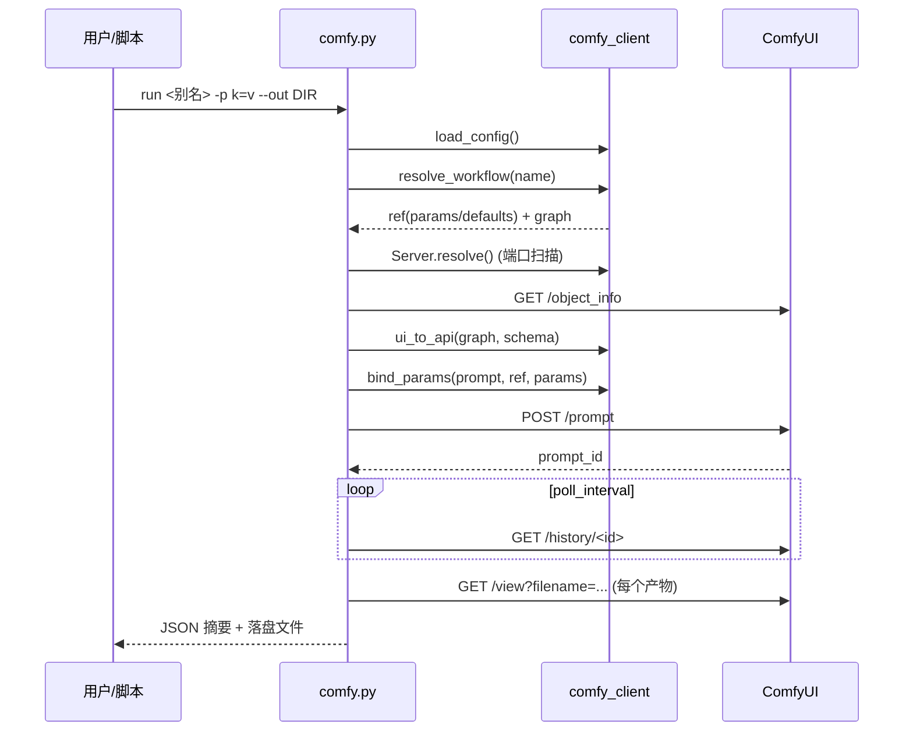

# 架构

## 1. 分层

```
┌─────────────────────────────────────────────────────────────┐
│ CLI  scripts/comfy.py                                        │
│   子命令 = 参数解析 + 输出格式化；不做业务逻辑                  │
├─────────────────────────────────────────────────────────────┤
│ 库   scripts/comfy_client.py                                 │
│   配置 · 服务发现 · HTTP · UI→API 转换 · 参数绑定 · 产物收集   │
├─────────────────────────────────────────────────────────────┤
│ 数据 registry.json（别名路由）  config.json（本机路径）        │
│      scripts/workflows/*.json（随仓库分发的 API 图）           │
└─────────────────────────────────────────────────────────────┘
                     ↓ HTTP（本地）
              ComfyUI 服务（用户自行启动）
```

**只有标准库**是硬约束：这样它能被直接拷进任何没有 pip 环境的机器（包括 Agent 的 skill 目录），不需要构建步骤。

## 2. 关键函数

| 函数 | 职责 |
|---|---|
| `load_config(overrides, config_path)` | 合并 默认值 < 配置文件 < 环境变量 < 覆盖项，并派生 `workflows_dir` / `output_dir` / `input_dir` / `python` |
| `class Server` | `resolve()` 端口扫描、`object_info()` schema 缓存、`submit()` / `wait()` / `download()` / `upload_file()` / `interrupt()` |
| `resolve_workflow(name, cfg)` | 别名 → 路径 → 工作流目录三级解析，返回 `(ref, data)` |
| `ui_to_api(nodes_links, object_info)` | UI 格式 → API 格式，返回 `(prompt, warnings)`；对子图/缺节点类抛 `ComfyError("workflow")` |
| `bind_params(prompt, ref, params, seed)` | 显式绑定 → 同名自动绑定 → 报错；返回值转换与 `applied` 摘要 |
| `collect_outputs(history, server, outdir, prefix)` | 遍历 `outputs`，下载文件型产物、聚合文本型产物 |
| `ComfyError(stage, message, hint)` | 携带阶段标记的异常，`exit_code` 由 `STAGE_EXIT` 映射 |

## 3. 一次 `run` 的时序



失败时在对应阶段抛出 `ComfyError`，CLI 统一转成 `{ok:false, stage, error, hint}` 并返回该阶段的退出码。

## 4. 设计取舍

| 取舍 | 原因 |
|---|---|
| **不启动/不重启** ComfyUI | 服务生命周期属于用户；Desktop 与命令行实例并存会抢显存，工具插手只会让状态更混乱 |
| **不自动重试提交** | 出图/配音有成本，重复提交=重复出图；只在"等待结果"阶段容忍偶发 HTTP 抖动 |
| **同名输入歧义就报错** | 猜错节点会静默生成错误内容，比报错更贵 |
| **UI→API 转换失败即拒绝** | 子图、未安装节点类无法可靠还原，硬转只会得到难懂的运行期错误 |
| **产物按 `<别名>-<时间戳>-<pid8>` 前缀命名** | 并发/批量时不互相覆盖，又能从文件名回溯是哪次任务 |
| **`--json` 双通道** | stdout 只放结果、stderr 只放错误，便于 shell 管道与其他语言解析 |

## 5. 扩展点

**加一个子命令**：在 `build_parser()` 里 `sub.add_parser(...)`，实现 `cmd_xxx(args, cfg)`，复用 `_run_workflow()` 即自动获得转换/绑定/等待/下载/JSON 能力。

**支持新的产物类型**：`comfy_client.FILE_KEYS` 加键名即可（例如 `"meshes"`），产物会按 `kind` 标注落盘。

**支持新的工作流格式**：在 `ui_to_api()` 入口做格式嗅探分支，返回同一 `prompt` 结构即可，下游无需改动。

**接入非 ComfyUI 后端**：`Server` 的 `_request` 已把 HTTP 细节收在一处；实现同名方法（`submit` / `wait` / `download` / `upload_file`）即可复用 CLI 与参数层。

## 6. 目录约定

- `SKILL_ROOT`（仓库根）= `scripts/` 的父目录，`config.json` 与 `registry.json` 都在这一级。
- 因此**整目录可迁移**：拷到哪里都能跑，不需要安装、不需要环境变量（除非你要覆盖配置）。
- `registry.json` 是运行时会被改写的文件，`config.json` 是纯本机配置，两者都在 `.gitignore` 的考虑范围内。
